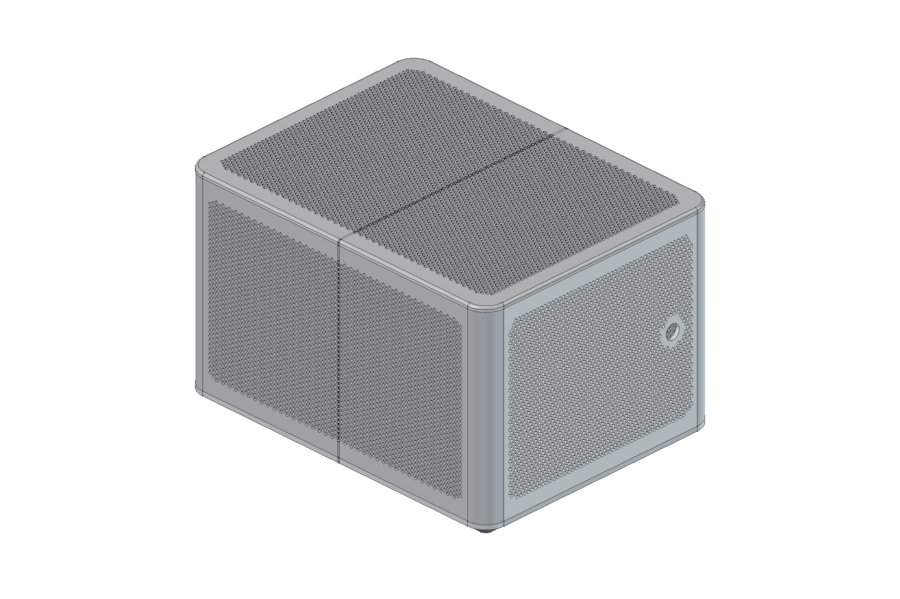
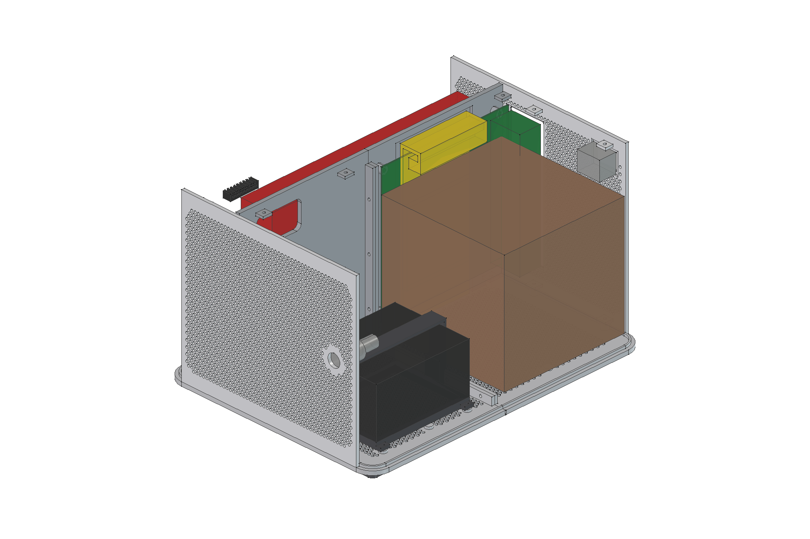

# ITX-Case – 3D-druckbares Mini-ITX-Gehäuse

Ein flacher, breiter Block im Stil des Mac Studio mit zwei Kammern. Von vorn gesehen steht links
die GPU aufrecht parallel zur Mittelwand, mit den Lüftern zur linken Seitenwand. Rechts sitzen
Board, Noctua NH-D15 und SFX-Netzteil. Ein flexibles Riser-Kabel verbindet beide Kammern. Die
Lüftung läuft nur über Felder aus kleinen runden Löchern: Front, Rückwand, beide Seitenwände,
der ganze Deckel, Boden und der rundum gelochte Sockel. Die Felder von Front, Rückwand und
Seitenwänden beginnen und enden auf derselben Höhe (14 und 196 mm über dem Boden).

| | |
|---|---|
| Außen (ohne Sockel) | 366 × 279 × 220 mm |
| Höhe mit Sockel | 232 mm |
| Innen | 358 × 271 × 210 mm |
| GPU-Kammer / Board-Kammer | 85 / 181 mm (5 mm Mittelwand) |
| Luft über dem Kühler | 6,4 mm |
| Drucker | Voron 2.4 300, Teile ≤ 290 × 290 × 270 mm |



## Layout: Das Board steht kopfüber

Eine Grafikkarte und ein Mainboard lassen sich nicht spiegeln. Steht die Karte mit den Kontakten
unten, dem Slotblech hinten und den Lüftern nach außen, dann steht sie von vorn gesehen links.
Das Board dahinter zeigt mit der Bestückung nach rechts und mit der I/O-Blende nach hinten.
In dieser Lage liegt seine Slot-Kante oben. Das Board steht also kopfüber, wie im Dan A4-SFX.

Das hat vier Folgen:

- Der Riser läuft vom Slot über die Oberkante des Boards, hinter dem Board in einer 3 mm tiefen
  Tasche der Mittelwand nach unten und unten durch die Mittelwand zur Karte. Die Bahn ist im
  Modell 231 mm lang (245 mm eckig gemessen). Ein 250-mm-Riser passt.
- Die Abstandshalter sind 8 mm hoch statt 6,35 mm. Hinter dem Board bleiben damit 11 mm für das
  Flachband (4 mm) und die Rückplatte des Kühlers (bis 6 mm).
- Der NH-D15 sitzt unten in der Kammer (z = 12 bis 162 mm), das Netzteil steht davor.
- Die Kaltgerätebuchse sitzt hinten oben rechts, weil unten der Kühler bis an die Rückwand reicht.

`params.py` und `parts/` rechnen mit y von links nach rechts. Das ist ein Linkssystem, FreeCAD
rechnet rechtshändig. `build.py` spiegelt deshalb jedes Teil vor dem Export an der Ebene
y = `INNER_W` / 2. STEP, STL und `assembly.FCStd` haben die richtige Händigkeit.

**Stände vor diesem Umbau nicht drucken.** Dort war das Gehäuse spiegelverkehrt modelliert.
Eine echte Karte hätte mit den Lüftern zur Mittelwand gezeigt.



## Bauen

```bash
/Applications/FreeCAD.app/Contents/Resources/bin/freecadcmd build.py   # STEP, STL, FCStd, Prüfungen
/Applications/FreeCAD.app/Contents/MacOS/FreeCAD render.py             # PNG-Ansichten (GUI)
```

`build.py` bricht mit Exit-Code 1 ab, wenn eine Prüfung fehlschlägt. Das Protokoll steht in
`out/report.txt`, die Teiletabelle in `out/parts.tsv`. Optionen lassen sich per Umgebungsvariable
setzen, ohne `params.py` zu ändern: `GPU_PROFILE=max`, `PSU_TYPE=SFX-L`, `QUICK=1` (nur Prüfungen,
kein Export).

| Pfad | Inhalt |
|---|---|
| `params.py` | alle Maße und Optionen |
| `parts/` | ein Modul pro Bauteilgruppe (`floor`, `lid`, `side_walls`, `panels`, `midwall`, `plinth`, `extras`, `dummies`) |
| `out/step/` | STEP pro Teil in Montagelage, `_baugruppe.step` komplett |
| `out/stl/` | STL pro Teil in Druckorientierung |
| `out/assembly.FCStd` | Montage mit Dummy-Komponenten (Gruppen Gehäuse/Halter/Komponenten) |
| `out/png/` | Ansichten von allen Seiten, beide Kammern offen, Explosionsansichten |

## Prüfungen (Stand des letzten Builds)

1. **Kollisionen:** Gehäuse und Halter gegen alle Dummies (Board mit I/O-Block und
   Kühler-Rückplatte, NH-D15, GPU mit 35-mm-Kabelbogen und Slotblech, Netzteil, Riser mit Stecker,
   Flachband und Sockel, Taster mit Bauraum für die Leitung, C14): Schnittvolumen 0. Druckteile
   untereinander: keine Überschneidung. Das gilt für die Profile `reaper`, `max` und `SFX-L`.
2. **Druckbett:** Alle Teile passen nach dem Drehen in die Druckorientierung auf das Bett.
3. **Manifold:** Alle 22 STLs sind geschlossene Körper ohne Non-Manifold-Kanten.

## Teileliste

Die Zeiten sind grobe Schätzungen aus Volumen und Oberfläche (0,4-mm-Düse, 0,2-mm-Schicht).
Der Slicer ist maßgeblich. Die vielen Löcher kosten im Slicer mehr Zeit, als die Schätzung zeigt.

| Teil | Druckmaß (mm) | Orientierung | Zeit | ASA |
|---|---|---|---|---|
| boden_vorn / boden_hinten | 179 / 187 × 279 × 15 | Unterseite aufs Bett | 7,2 h + 7,4 h | 231 g |
| deckel_vorn / deckel_hinten | 181 / 189 × 283 × 15 | Oberseite aufs Bett | 6,8 h + 7,1 h | 200 g |
| seite_links_vorn / _hinten | 179 / 187 × 22 × 210 | stehend | 4,6 h + 4,8 h | 136 g |
| seite_rechts_vorn / _hinten | 179 / 187 × 22 × 210 | stehend | 4,6 h + 4,8 h | 136 g |
| front | 210 × 235 × 14 | Sichtseite aufs Bett | 5,6 h | 75 g |
| rueckwand | 210 × 235 × 17 | Sichtseite aufs Bett | 4,3 h | 62 g |
| mittelwand_vorn / _hinten | 173 / 182 × 210 × 15 | GPU-Seite aufs Bett | 5,0 h + 4,2 h | 184 g |
| sockel_vorn / _hinten | 163 / 171 × 247 × 12 | stehend, Lippe unten | 1,1 h + 1,1 h | 28 g |
| netzteil_halter | 137 × 112 × 31 | wie eingebaut | 0,9 h | 17 g |
| netzteil_buegel | 143 × 56 × 20 | Steg aufs Bett | 0,6 h | 9 g |
| riser_halter | 161 × 14 × 21 | wie eingebaut | 0,4 h | 4 g |
| riser_traeger | 129 × 20 × 10 | wie eingebaut | 0,4 h | 5 g |
| gpu_stuetze | 47 × 16 × 21 | wie eingebaut | 0,3 h | 3 g |
| kabelkamm | 38 × 10 × 8 | wie eingebaut | 0,2 h | 1 g |
| passtest_board | 182 × 184 × 10 | flach | 1,6 h | 23 g |
| passtest_rueckwand | 185 × 131 × 15 | flach | 1,1 h | 15 g |
| **Summe Gehäuse + Halter** | | | **ca. 71 h** | **ca. 1,1 kg** |

**Zuerst die zwei Passtest-Teile drucken.** Sie prüfen die Maße, die nicht sicher sind (siehe
unten), mit echtem Board und echter Karte, bevor 72 Stunden Druckzeit anfallen.

## Einkaufsliste

| Teil | Menge | Hinweis |
|---|---|---|
| M3-Einschmelzmuttern, 5–5,7 mm lang, Außen-Ø ca. 4,6 | 50 | 35 verbaut (Bohrung Ø4,1, Tiefe 5,5) |
| Zylinderkopfschrauben M3 × 8 | 45 | Wandlaschen, Netzteil, Riser, GPU-Stütze, Leiste, Sockel an Boden (4 Stück, Köpfe im Pfosten versenkt) |
| Zylinderkopfschrauben M3 × 12 | 30 | Trennflansche (2 × 4 mm) |
| Zylinderkopfschrauben M3 × 6 | 10 | Board auf Einschmelzmuttern, GPU-Slotblech |
| M3-Muttern (DIN 934) | 30 | Flansche, Mutternkanal der GPU-Leiste |
| Neodym-Scheibenmagnete 10 × 3 mm | 16 | 8 im Deckel, 8 in den Seitenwänden, **Polung beachten** |
| PCIe-4.0-x16-Riser mit flexiblem Flachband, 250 mm | 1 | Bauart wie für Sandwich-Gehäuse. Der Stecker ist gewinkelt, das Band verlässt ihn Richtung Slot-Kante des Boards. Die Buchse steht am anderen Ende gerade nach oben. Vor dem Kauf ein Foto des Risers mit `out/png/05b_offen_board_iso.png` vergleichen. |
| C14-Einbaubuchse, Schnappbefestigung, Ausschnitt 27,5 × 19,8 mm, Wandstärke 1–2 mm | 1 | mit internem Kabel C14 auf C13 gewinkelt, ca. 50 cm (Buchse hinten oben, Netzteil vorn unten) |
| Vandalismus-Taster 16 mm, Taster (nicht rastend), max. 28 mm Einbautiefe | 1 | mit zweipoliger Leitung und Dupont-Buchse 2,54 mm für den F_PANEL-Anschluss des Boards (PWR_SW), 30–40 cm |
| Gummifüße selbstklebend, Ø8 × 2–3 mm | 8 | auf die Sockellippe |
| optional: USB-C-Einbaubuchse mit Verlängerung | 1 | `USB_C = True` |
| SFX-Netzteil ≥ 750 W | 1 | PowerColor empfiehlt für die Reaper mindestens 750 W |

## Slicer-Einstellungen (Voron 2.4, ASA)

| Einstellung | Wert |
|---|---|
| Material | ASA (bevorzugt, wärmefest) oder PETG |
| Düse / Schicht | 0,4 mm / 0,2 mm (Sichtteile 0,16 mm) |
| Perimeter | 4 (Wände 4 mm werden damit fast voll) |
| Ober-/Unterlagen | 5 / 5 |
| Infill | 25 % Gyroid |
| Stützen | **keine**, alle Teile sind stützenfrei ausgelegt |
| Bett / Düse | 105 °C / 250–260 °C (ASA), Kammer geschlossen und aufgeheizt |
| Kühlung | 20–40 % ASA, nur für Brücken mehr |
| Brim | 5 mm bei Seitenwänden und Sockel (hoch und schmal) |
| Nahtposition | hinten bzw. an der Innenseite (`Rear` / gemalt) |
| Bügeln | Deckel- und Bodenunterseite optional (Sichtflächen liegen auf dem Bett, Textur-PEI ergibt eine gleichmäßige Oberfläche) |

Die Stege zwischen den Löchern sind 1,3 mm breit. In der Slicer-Vorschau prüfen, dass sie ohne
Lücke gefüllt sind. Falls nicht, hilft der Arachne-Wandgenerator. In den Seitenwänden und im
Sockel liegen die Löcher beim Druck waagerecht. Bei Ø3,2 und Ø3,8 geht das ohne Stützen.

Einschmelzmuttern mit einer Lötspitze bei ca. 245 °C setzen.

## Montage-Reihenfolge

Die Reihenfolge folgt der Zugänglichkeit der Schrauben. Die Deckelschrauben der Board-Kammer
sitzen hinter dem Board bzw. über dem I/O-Block und gehen nur bei leerer Kammer. Die
GPU-Lasche wird von oben verschraubt, also vor dem Deckel. Das Flachband des Risers liegt hinter
dem Board und muss vor dem Board hinein.

1. **Passtest:** `passtest_board` mit dem Board verschrauben (Muttern hinten), `passtest_rueckwand`
   über die Zapfen stecken. Prüfen: I/O-Blende rastet im Fenster ein. Riser einstecken, Karte mit
   Slotblech an die Leiste setzen: Die Lasche muss auf der Leiste aufliegen, und die Karte darf
   nicht an der Leiste anstoßen. Abweichungen in `params.py` korrigieren (`ITX_HOLE_C`,
   `IO_FROM_SLOT_EDGE`, `BRACKET_TAB_ABOVE_FINGERS`, `GPU_RAIL_H`).
2. **Einschmelzmuttern** in alle Dome und Bossen setzen: Boden von oben, Sockelbossen von unten,
   Deckel von unten, Abstandshalter der Mittelwand, Pfosten des Netzteil-Halters.
3. **Magnete** in Deckel und Seitenwände kleben (Sekundenkleber oder Epoxid). Vorher die Polung
   festlegen: Deckel-Magnete alle mit Nordpol nach unten, Seitenwand-Magnete mit Südpol nach oben.
4. **Hälften verschrauben:** Boden, Deckel, Sockel, Mittelwand und beide Seitenwände jeweils an den
   Flanschen mit M3 × 12 und Mutter. Die V-Nut außen sauber ausrichten, erst dann anziehen.
5. **Sockel unter den Boden** schrauben (4 × M3 × 8 von unten durch die Pfosten), Gummifüße auf
   die Lippe kleben.
6. **Halter auf den Boden:** Riser-Halter und GPU-Stütze (Langlöcher nur leicht anziehen),
   Netzteil-Halter. Netzteil flach auflegen (Lüfter nach unten, Rückseite zur rechten Seitenwand),
   Bügel überlegen und seitlich verschrauben. Die vordere Bügelschraube geht nur, solange die
   Front noch nicht montiert ist.
7. **Front** und **Rückwand:** Vorher den Taster in die Front schrauben und die C14-Buchse in die
   Rückwand schnappen. Beide Wände an den Randfalz stellen und unten über die Laschen in die
   Bodendome schrauben. Die C14-Verlängerung oben an der rechten Seite nach vorn zum Netzteil
   führen. Die Taster-Leitung bleibt lose. Sie geht später an den F_PANEL-Anschluss des Boards
   (PWR_SW, Polung egal). Der Taster hat keine Verbindung zum Netzteil.
8. **Mittelwand** einsetzen und unten verschrauben.
9. **Riser:** Das Flachband auf der Board-Seite in die Tasche der Mittelwand legen. Das Ende mit
   der Buchse unten durch die Durchführung in die GPU-Kammer führen, das Ende mit dem Stecker
   oben aus der Tasche hängen lassen. Die Buchse auf den Träger schrauben, Höhe und Länge über
   die Langlöcher einstellen.
10. **GPU-Kammer:** Karte einstecken, M3-Mutter im Kanal der Leiste an die Slotposition schieben,
    Lasche von oben verschrauben. GPU-Stütze unter die Kartenvorderkante schieben und festziehen.
    Stromkabel oben vorn durch die Mittelwand führen, mit dem Kabelkamm ordnen.
11. **Deckel** aufsetzen und von innen über die Laschen verschrauben: 3 × Front, 2 × Rückwand,
    3 × Mittelwand. Die Board-Kammer ist dabei noch leer.
12. **Board** ohne Kühler, aber mit montierter Kühler-Rückplatte kopfüber auf die Abstandshalter
    schrauben: I/O hinten, Slot oben. Das Flachband liegt dabei hinter dem Board. Den Riserstecker
    über die Oberkante des Boards in den Slot stecken.
13. **NH-D15** am Board montieren (Lüfter blasen nach hinten), Kabel anschließen, Taster-Leitung
    auf PWR_SW stecken.
14. **Seitenwände** unten in den Randfalz stellen und oben andrücken: Die Magnete halten sie.
    Zum Öffnen oben nach außen kippen und abheben.

Zum Abnehmen des Deckels müssen Kühler und Board wieder heraus (Schritte 13 bis 11 rückwärts).

## Luftstrom und freie Querschnitte

Die Löcher haben Ø3,2 im Wabenraster mit 4,5 mm Abstand (theoretisch 45,9 % offen), im Sockel
Ø3,8 mit 5 mm Abstand. In Deckel, Seitenwänden und Sockel laufen die Felder ohne Lücke über die
Trennfuge, eine Lochspalte liegt genau auf der Fuge. Wo innen ein Fugenflansch, ein Schraubdom
oder eine Magnetnase hinter dem Feld sitzt, sind die Löcher Sacklöcher mit 0,6 mm Haut
(`VENT_BLIND_SKIN`). Von außen sieht das Feld dadurch überall gleich aus. Sacklöcher und die
Löcher über der Mittelwand zählen nicht zum Querschnitt.

| | Fläche | Bemerkung |
|---|---|---|
| **Zuluft** Front vor der Board-Kammer | 124 cm² | gerade vor dem CPU-Kühler |
| Sockelring | 44 cm² | Engstelle der Bodenzuluft, zusätzlich ca. 35 cm² Spalt unter der Lippe bei 3-mm-Füßen |
| Boden über dem Sockel | 294 cm² | |
| Linke Seitenwand vor der GPU | 250 cm² | 43,7 % offen vor der Karte |
| **Abluft** Rückwand Board-Kammer | 82 cm² | ein 140-mm-Lüfter hat ca. 139 cm² freie Fläche |
| Deckel über der Board-Kammer | 239 cm² | |
| Rechte Seitenwand hinter dem Netzteil | 32 cm² | Netzteil-Abluft |
| Deckel über der GPU-Kammer | 102 cm² | |
| Rückwand GPU-Kammer | 18 cm² + ca. 29 cm² | Lochfeld plus Slotblech |
| Front vor der GPU-Kammer | 48 cm² | |
| **Ohne feste Richtung** rechte Seitenwand neben Kühler und Board | 217 cm² | nicht in den Summen |
| **Summe** | Zuluft 418 cm², Abluft 550 cm² | zum Vergleich: 3 × 95-mm-GPU-Lüfter ca. 194 cm², 2 × 140 mm am D15 ca. 277 cm² |

Der D15 bläst von vorn nach hinten. Er saugt durch die Front an und bläst durch die Rückwand aus.
Das Netzteil steht vorn unten und verdeckt nur die unteren 75 mm der Front, darüber ist der Weg
zum Kühler frei. Hinter dem D15 bleibt wegen des I/O-Fensters nur ein Teil der Rückwand für
Löcher. Was dort nicht hinauspasst, zieht nach oben durch den Deckel ab. Der Boden hat zwei lochfreie
Streifen, einen unter der Mittelwand und einen 8 mm breiten am Flansch der Trennfuge.

Der offene Deckel hat einen Preis: Staub und verschüttete Flüssigkeit fallen direkt auf Board
und Karte, und der Deckel dämpft die Lüfter weniger. Auf dem Deckel sollte nichts liegen.

Stellschrauben in `params.py`:

- `FRONT_VENT = None` schließt die Front. Mit `y0 = MID_Y1 + 4` bleibt nur das Feld vor der
  Board-Kammer.
- `VENT_Z0` und `VENT_Z1` legen Unter- und Oberkante aller Wandfelder gemeinsam fest.
- `TOP_VENT` ist das Feld im Deckel. Mit `y1 = MID_Y0 - 5` liegt es nur über der GPU-Kammer.
- `BOARD_SIDE_VENT = None` schließt die rechte Seitenwand bis auf das Feld hinter dem Netzteil
  (`PSU_VENT`).
- `REAR_VENT` und `GPU_SIDE_VENT` legen die übrigen Felder fest.
- `VENT_D` und `VENT_PITCH` gelten für alle Felder außer dem Sockel.

## Entscheidungen

- **GPU links, Board rechts und kopfüber.** Der Grund steht oben im Abschnitt Layout. Die
  Alternative wäre ein normal stehendes Board links und eine hängende Karte rechts mit den
  Kontakten nach oben.
- **Front mit Lochfeld über die ganze Fläche.** Der CPU-Kühler bekommt so Luft auf geradem Weg.
  Das Feld hat dasselbe Bild wie die Rückwand. Die Löcher vor der Stirnkante der Mittelwand
  enden an der Mittelwand, damit das Feld außen keine Lücke hat.
- **Taster rechts auf halber Höhe, mit eigener Leitung zum Board.** Er sitzt frei über dem
  Netzteil und hat 50 mm Bauraum nach hinten. Um ihn bleibt ein lochfreier Kreis mit 13 mm Radius
  als Auflage für Kragen und Mutter. `BUTTON_Y` und `BUTTON_Z` verschieben ihn.
- **Abstandshalter 8 mm** statt 6,35 mm, damit Flachband und Kühler-Rückplatte hinter das Board
  passen. Über dem D15 bleiben dadurch 6,4 mm statt 8,4 mm.
- **Tasche für das Flachband in der Mittelwand**, 3 mm tief. Dort bleiben 2 mm Wand stehen.
- **Wandstärke 4 mm überall** statt 3 mm an den Seiten. Seitenwand-Eckbögen und Front/Rückwand
  stoßen dadurch bündig aneinander. Folge: außen 279 statt ca. 277 mm breit.
- **Ein Lochbild für alle Felder** (Ø3,2 im 4,5-mm-Raster). Vor der Karte sind 43,7 % offen, die
  Vorgabe war mindestens 40 %.
- **Deckel mit Lochfeld über die ganze Fläche**, 16 mm vom Rand. Im Rand sitzen die Magnete und
  die Dome für Front und Rückwand.
- **Beide Seitenwände mit dem gleichen Feld**, auf gleicher Höhe wie Front und Rückwand und mit
  gleichem Abstand zu den Eckbögen. Die rechte Wand hatte vorher nur ein kleines Feld hinter dem
  Netzteil.
- **Seitenwand-Flansche nur oben und unten** (je ein kurzes Paar). Das Lochfeld läuft über die
  Fuge durch, vor den Flanschen als Sacklöcher.
- **Sockel rundum gelocht**, auch in den Eckbögen. Schraubpfosten und Fugenflansche stehen frei
  hinter dem Ring, damit sie kein Loch verdecken.
- **GPU-Kammer bleibt 85 mm** für Karten bis 340 × 140 × 65 mm (Profil `max`), obwohl die Reaper
  nur 42 mm dick ist. Sie hat dadurch 40 mm Luft vor den Lüftern.
- **Laschen der Mittelwand nur auf der Board-Seite.** Oben sitzen sie außerhalb des Riser-Bogens
  (x = 30, 140, 351).
- **Rückwand oben in der GPU-Kammer ohne Lasche**, wegen des Kabelbogens. Gehalten wird sie dort
  von der Leiste und der Mittelwand-Nachbarschaft.
- **Netzteil 25 mm vor der Seitenwand**, damit ein gewinkelter C13-Stecker in die Netzteilbuchse
  passt.
- **Deckelkante: Rundung r 2,5 mit 1 mm 45°-Fase am Rand.** Der Deckel liegt mit der Sichtseite
  auf dem Bett. Eine reine Rundung würde dort in den ersten Schichten ausfransen. Die Fase ist
  nur von unten sichtbar (`LID_EDGE_BED_CHAMFER = 0` gibt die reine Rundung zurück).
- **Trennflansche stützenfrei:** An den Seitenwänden reicht das untere Flanschpaar bis aufs Bett
  (neben dem Randfalz), das obere hat einen 45°-Keil. Die Sockelflansche stehen auf dem Bett.
- **V-Nut** an allen Außenkanten der Trennstellen als 0,8-mm-Fase je Hälfte (`out/report.txt`
  listet die Kanten pro Teil).
- **Gemeinsame Trennstelle x = 175 mm** für Boden, Deckel, Sockel, Mittelwand und Seitenwände.
  Alle Fugen liegen außen in einer Linie.

## Unsicher – mit dem Passtest prüfen

| Maß | Wert in `params.py` | Stand |
|---|---|---|
| ITX-Lochbild | C(0,0), F(154,94; 0), H(22,86; 157,48), J(154,94; 157,48) mit erster Koordinate **Richtung vorn**, zweiter **quer** | Abstände sind die 0,1"-Rasterwerte aus ATX/microATX (6,1" / 6,2" / 0,9"). Deine Liste stimmt, wenn die erste Koordinate Richtung vorn zählt; quer gelesen läge die vordere Lochreihe nur 2,4 mm vor der Platinenkante. Loch C: 10,16 mm von der I/O-Kante, 6,17 mm von der Slot-Kante – aus Zeichnungen, nicht aus der Spezifikation. Im Gehäuse liegt die Slot-Kante oben. |
| I/O-Fenster | 158,75 × 44,45, Unterkante 3,81 unter Platinenoberseite, Wand 1,2 mm, Ecken r 0,99, Sperrzone 2,5 | Aus ATX 2.2, Abschnitt 3.3.5 (Text). Die Lage entlang der Kante (`IO_FROM_SLOT_EDGE` = 5,6) ist geschätzt; die Zeichnung (Fig. 3/4) war nur als Bild verfügbar. |
| PCIe-Slotblech | Länge 120,02, Slotabstand 20,32, Lasche 112 über der Fingerunterkante, Leiste 6 mm hoch | Slotabstand sicher (0,8"). Laschenhöhe und Freiraum unter der Lasche geschätzt. |
| Riser | Bahn 231 mm, Flachband 4 mm dick, Stecker ragt 16 mm aus dem Slot | Gewinkelter Stecker angenommen, kein konkretes Modell. Länge und Steckerform am gekauften Riser prüfen, bevor die Mittelwand gedruckt wird. |
| Platz hinter dem Board | 11 mm, davon 8 mm Abstandshalter und 3 mm Tasche | Kühler-Rückplatte mit 6 mm angenommen (`CPU_BACKPLATE`). Eine M.2-SSD auf der Rückseite des Boards hat 6 mm bis zum Flachband und bekommt wenig Luft. |
| NH-D15-Höhe | 165 mm ab Platine | Die Noctua-Seite nennt für den NH-D15 G2 168 mm (`COOLER_PROFILE = "NH-D15 G2"` lässt dann 3,4 mm Luft). |
| Reaper-Maße | 304 × 127 × 42 mm (mit Blech), 2 × 8-Pin | Händlerangaben; Karte ohne Blech 289 × 111 × 41. |
| Sockel-/Slotlage | Sockel 90 mm von I/O, 105 mm von der Slot-Kante; Slot 10 mm von der Kante, 45–134 mm von I/O | Parameter, für das kommende Board anpassen. Für das Z590I Vision D nicht verifiziert. |
| Netzteil und C14 | SFX 125 × 63,5 × 100; C14-Schnappbuchse 27,5 × 19,8 | Typ festgelegt, konkretes Modell offen. |

**Option 4 Slots:** Bei `GPU_SLOTS = 4` reicht die Slotöffnung (81 mm) in den Eckbogen der
Rückwand (die ebene Fläche beginnt bei y = 18). Für eine 4-Slot-Karte müsste die GPU-Kammer
breiter werden (`GPU_THICK_MAX`), `build.py` warnt dann.
