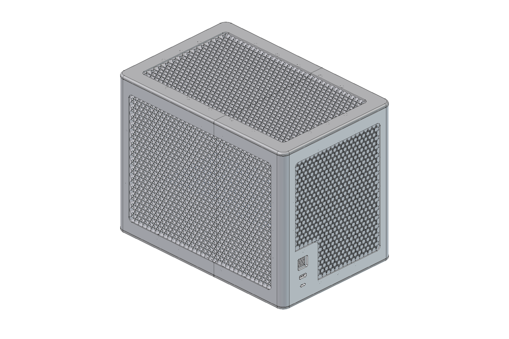
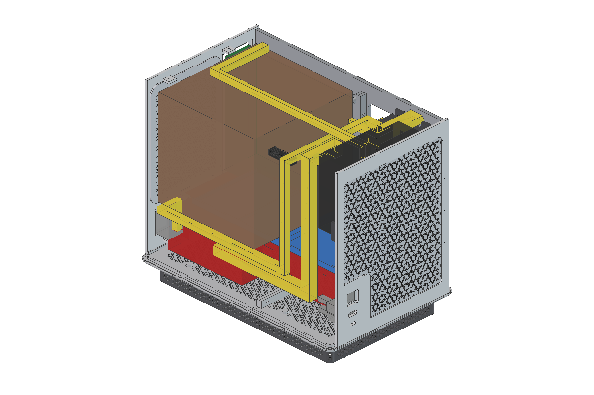
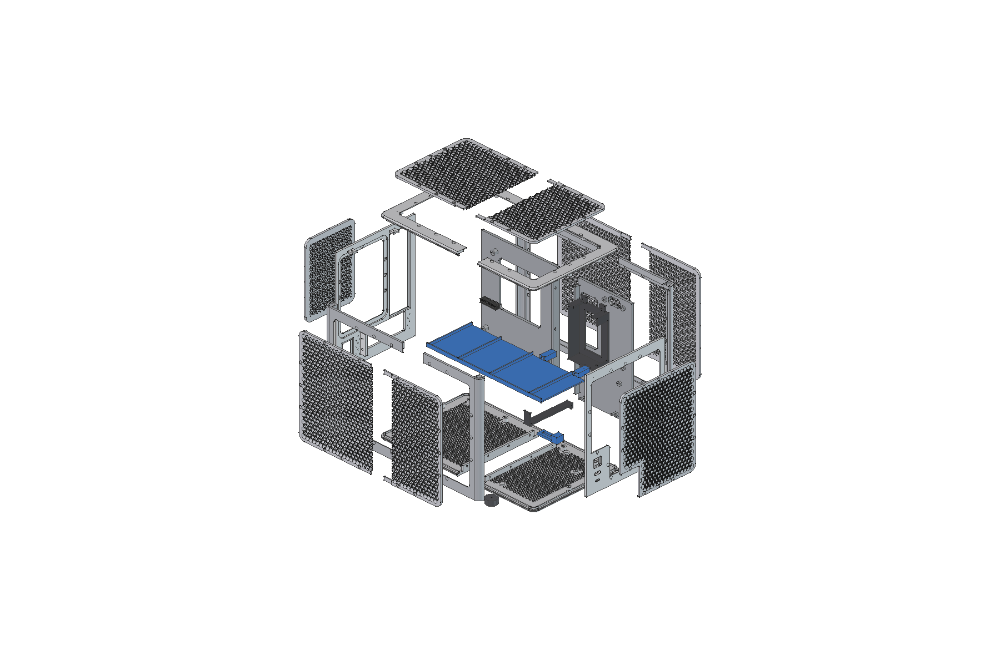

# ITX-Case – 3D-druckbares Mini-ITX-Gehäuse

Ein Gehäuse im Stil des Mac Studio für Mini-ITX-Board, Noctua NH-D15, PowerColor RX 9070 XT
Reaper und SFX-Netzteil. Die Karte steckt direkt im Slot, es gibt kein Riser-Kabel. Board,
Karte, Kühler und Netzteil bilden damit einen festen Block. Das Repo baut drei Varianten, die
diesen Block verschieden ins Gehäuse stellen:

- **A liegend:** Das Board liegt flach auf dem Boden, der Kühler steht nach oben, die Karte steht
  senkrecht und saugt durch die linke Seitenwand an. Breit und flach.
- **B stehend:** Das Board sitzt auf einem Träger vor der rechten Seitenwand, die Karte liegt
  waagerecht und saugt durch Boden und Sockel an. Ein gewöhnlicher Tower, schmal und hoch. Alle
  sichtbaren Lüftungsfelder (Front, Deckel, Seitenwände, Rückwand) sind Einleger im
  Reibenmuster des Mac Pro 2019 mit Filter dahinter. Der Sockel ist 26 mm hoch und grob gelocht.
  Das ist die Variante, die fertig ausgearbeitet wird.
- **C stehend im Stil des NCase M3 Grater:** wie B, aber mit vier Füßen statt Sockelring, der
  Boden ist rundum offen. Es ist ein Nachbau nach den öffentlichen Angaben, ohne Logo und ohne
  die Original-Geometrie.

Bei A läuft die Lüftung über Felder aus kleinen runden Löchern: Front, Rückwand, beide
Seitenwände, der ganze Deckel, Boden und der rundum gelochte Sockel. Bei B und C sind alle
sichtbaren Felder Reibe, nur Boden und Sockelring behalten Rundlöcher.

| | A liegend | B stehend | C M3-Stil |
|---|---|---|---|
| Außen (ohne Sockel/Füße) | 322 × 245 × 190 mm | 322 × 211 × 247 mm | 322 × 211 × 247 mm |
| Höhe mit Sockel/Füßen | 202 mm | 273 mm | 259 mm |
| Volumen außen | 15,7 l | 18,1 l | 16,8 l (ohne Füße) |
| Innen | 314 × 237 × 180 mm | 314 × 203 × 237 mm | wie B |
| GPU saugt durch | linke Seitenwand, 44,0 % offen | Boden, Engstelle Sockelring 98 cm² | Boden, Spalt unter dem Boden 116 cm² |
| Offen: Front / Deckel / Seite / Rückwand | 139 / 264 / 190 / 84 cm² | 122 / 183 / 222 / 61 cm² (Reibe) | wie B |
| Fugen | V-Nut | versteckt, verklebt | versteckt, verklebt |
| Druckteile | 18 | 28 | 30 |
| Druckzeit / ASA (Gehäuse und Halter) | ca. 48 h / 0,7 kg | ca. 56 h / 0,9 kg | ca. 54 h / 0,9 kg |

Drucker: Voron 2.4 300, alle Teile ≤ 290 × 290 × 270 mm.

| A liegend | B stehend | C M3-Stil |
|---|---|---|
|  |  |  |
|  |  |  |

## Der gemeinsame Block

Eine Grafikkarte und ein Mainboard lassen sich nicht spiegeln. Liegt das Board mit der
Bestückung nach oben und der I/O-Blende hinten, dann liegt seine Slot-Kante links. Die Karte
steckt dort senkrecht im Slot, ihre Backplate zeigt zum Board, die Lüfter zeigen nach links.
Das ist Variante A. Dreht man A um die Längsachse auf die rechte Seite, entsteht B.

`params.py` beschreibt den Block in eigenen Koordinaten (u, v, w): u läuft von vorn nach
hinten, v quer zum Slot (0 ist die Wand vor den GPU-Lüftern), w ist die Höhe über der
Board-Ebene. `params.to_case` und `parts.common.place` stellen den Block ins Gehäuse. Bei A ist
die Board-Ebene der Boden, bei B die Vorderseite des Trägers.

- **Netzteil hochkant vor dem Board**, Lüfter zur Front, Rückseite mit Anschlüssen zur Wand bei
  v = `INNER_V` (A: rechte Seitenwand, B: Deckel), 25 mm Abstand für einen gewinkelten
  C13-Stecker. Vor dem D15 bleiben 64 mm Luft. Flach liegend wären es nur etwa 5 mm, dann würde
  das Netzteil die untere Hälfte des vorderen D15-Lüfters zudecken.
- **Kaltgerätebuchse** in der Rückwand über der Karte (A oben links, B unten links).
- **Einschalter** vorn mit eigener Leitung zum F_PANEL-Anschluss des Boards: bei A ein
  16-mm-Taster oben rechts, bei B und C eine mechanische Taste in der Front-I/O-Insel unten
  links (siehe unten).
- **Abstandshalter 8 mm** statt 6,35 mm, damit die Rückplatte des Kühlers (6 mm angenommen)
  unter das Board passt.
- **Trennstelle bei x = 130 mm**, vor dem Kühler. So stößt kein Flansch an Kühler, Board oder
  Rückplatte.

`params.py` und `parts/` rechnen mit y von links nach rechts. Das ist ein Linkssystem, FreeCAD
rechnet rechtshändig. `build.py` spiegelt deshalb jedes Teil vor dem Export an der Ebene
y = `INNER_W` / 2. STEP, STL und `assembly.FCStd` haben die richtige Händigkeit.

Das frühere Sandwich-Layout mit Riser liegt im Tag `sandwich-v1`.

## Versteckte Fugen (B und C)

Kein Teil passt in voller Länge (322 mm) auf das 290-mm-Bett, Deckel, Boden, Seitenwände und
Sockel sind deshalb bei x = 130 mm geteilt. Bei B und C ist diese Fuge versteckt:

- Keine V-Nut, die Hälften werden stumpf gestoßen und verklebt (ASA: ABS-Kleber oder
  Aceton-Lösung, PETG: Sekundenkleber). Danach die Fuge leicht überschleifen.
- Die Schraubenlöcher in den Flanschen sind eng (Ø3,15). Die M3-Schrauben richten die Hälften
  damit bündig aus, bevor der Kleber anzieht.
- In Boden und Sockel läuft die Fuge genau durch eine Lochspalte.
- Deckel und Seitenwände haben je ein durchgehendes Reibenfeld ohne Steg. Die zwei Einleger
  stoßen in einer Reihe aus Muldenmitten und Löchern aneinander. Im glatten Auflagerand greift
  das vordere Teil 20 mm unter das hintere, so tragen sich beide an den Enden der Fuge. Die
  Seitenwand-Rahmen sind nur in den Randstreifen über und unter dem Feld verbunden, dort sitzen
  die Flansche.
- Das Deckelfeld hat rundum denselben Abstand zum Rand wie Front und Seiten (16 mm bis zur
  Tasche). Für Flansche bleibt im Deckelrand kein Platz. Jede Deckelhälfte ist mit Front bzw.
  Rückwand verschraubt, die Fuge wird nur verklebt. Die oberen Laschen des Board-Trägers sitzen
  deshalb auf seiner Rückseite im Kabelraum und werden bei abgenommener rechter Seitenwand
  verschraubt.
- Sichtbar bleibt eine Haarfuge in den glatten Randstreifen.

`HIDDEN_SEAMS = False` in `params.py` bringt die V-Nut zurück. Wenn die Haarfugen stören, wäre
der nächste Schritt eine Teilung an den Kanten: Front- und Rückkappen, die um die Ecken greifen.

## Reibe (B und C)

Front, Deckel, Seitenwände und Rückwand sind Rahmen. Außen bleibt eine 1,5 mm dicke Lippe
stehen, das Fenster darin ist 7 mm kleiner als der Einleger. Der Einleger sitzt von innen an
der Lippe, dazwischen liegt das Filtergewebe. Magnetpaare 6 × 1 mm halten ihn, eines in der
Lippe und eines im Einleger. Die Rückwand hat ihr Feld im freien Rechteck neben I/O-Blende,
Slotblech und C14. Ihre übrigen glatten Flächen tragen blinde Mulden im selben Raster (ohne
Loch, 0,8 mm Restwand), damit auch die Rückseite einheitlich aussieht.

Alle Reibenfelder haben rundum denselben Abstand zum Außenrand: 16 mm bis zur Tasche, 23 mm bis
zum sichtbaren Feld. Dafür halten die Seitenwände mit je zwei Magneten in den Eckbögen statt
vier in der Mitte, und eine 2 mm breite Leiste unter dem Deckel führt ihre Oberkante. Unter
dem Deckel und über dem Boden läuft eine Schattenfuge von 1 × 1 mm rundum, die Unterkante des
Bodens ist wie die Deckelkante mit 2,5 mm gerundet.

## Front-I/O (B und C)

Unten links in der Front bleibt eine glatte Insel von 44 × 62 mm stehen, die Reibe läuft
L-förmig darum herum. Auf der Insel sitzen von oben nach unten:

- **Einschalter:** eine mechanische Tastaturtaste, Kailh Choc v1 (Low Profile) mit Kappe. Sie
  klemmt in einer 1,2 mm dünnen Platte am Grund einer Tastenmulde, die Kappe steht etwa 3 mm
  vor. Zwei Drähte gehen an PWR_SW. Mit `SWITCH = "mx"` wird es ein normaler MX-Schalter
  (Platte 1,5 mm), dessen Kappe aber gut 10 mm vorsteht.
- **USB-A** als Einbaubuchse mit Kabel auf den USB-3.0-Header (19-Pin) des Boards.
- **USB-C** als Einbaubuchse mit Kabel auf den Typ-E-Header des Boards.

Hinter der Insel sind bis 35 mm Tiefe frei, rechts daneben beginnt die Karte (3 mm Abstand
zu den USB-Buchsen). Die
Ausschnitte für die USB-Buchsen (`USBA_CUT`, `USBC_CUT`) sind Annahmen. Die Befestigung hängt
vom gekauften Bauteil ab: kleben oder einen Halter nach Maß ergänzen, wenn die Buchsen da sind.

Der Einleger ist 4 mm dick. Außen liegen Kegelmulden mit 45° Flanke im 8-mm-Wabenraster, die
sich an Graten treffen. An jedem Punkt, an dem drei Mulden zusammenstoßen, geht ein
Ø3,6-Loch durch, und die Spitze jeder Mulde hat ein kleines Loch. Offen sind 40 % der
Fensterfläche. Mit Sacklöchern statt Durchgangslöchern wären es nur 15 %, dann bekäme der D15
durch die Front zu wenig Luft. Die Maße stehen in `params.py` unter `GR_*`.

Die Einleger werden mit der Außenseite nach oben gedruckt. Die Mulden sind dann nach oben
offene 45°-Flächen und brauchen keine Stützen, zeigen aber Schichtstufen. Die Rahmen liegen
wie bei A und B mit der Sichtseite auf dem Bett.

Zum Reinigen der Filter nimmt man Deckel und Seitenwände ab (Magnete) bzw. schraubt Front oder
Rückwand ab und zieht den Einleger nach innen heraus. Bei C sitzen die vier Füße (Ø24 × 12 mm)
auf den Schraubpunkten, an denen bei B der Sockel hängt.

## Bauen

```bash
LAYOUT=A /Applications/FreeCAD.app/Contents/Resources/bin/freecadcmd build.py   # STEP, STL, FCStd, Prüfungen
LAYOUT=A /Applications/FreeCAD.app/Contents/MacOS/FreeCAD render.py             # PNG-Ansichten (GUI)
```

`LAYOUT=B` baut die stehende Variante, `LAYOUT=C` die im M3-Stil. Die Vollbauten von B und C
dauern 15 bis 20 Minuten, die Einleger haben je über tausend Kegel und Löcher. `build.py` bricht mit Exit-Code 1 ab, wenn eine Prüfung
fehlschlägt. Das Protokoll steht in `out/<LAYOUT>/report.txt`, die Teiletabelle in
`out/<LAYOUT>/parts.tsv`. Weitere Optionen per Umgebungsvariable: `GPU_PROFILE=max`,
`PSU_TYPE=SFX-L`, `QUICK=1` (nur Prüfungen, kein Export). Andere Profile landen in
`out/<LAYOUT>-<GPU>-<Netzteil>/` und sind nicht im Repo.

Die Innenmaße folgen aus dem Profil. `GPU_PROFILE=max` prüft also nicht, ob eine größere Karte in
das Reaper-Gehäuse passt, sondern baut ein größeres Gehäuse für Karten bis 340 × 140 × 65 mm
(A außen 358 × 268 × 203 mm, 20,4 l).

| Pfad | Inhalt |
|---|---|
| `params.py` | alle Maße und Optionen |
| `parts/` | ein Modul pro Bauteilgruppe (`floor`, `lid`, `side_walls`, `panels`, `tray`, `plinth`, `grater`, `extras`, `dummies`) |
| `out/A/`, `out/B/`, `out/C/` | je Variante: `step/` (je Teil in Montagelage), `stl/` (Druckorientierung), `assembly.FCStd` mit Dummies, `png/` |

`build.py` schreibt zusätzlich `step/_baugruppe.step` mit allen Teilen. Die Datei ist bei B und C
über 200 MB groß und liegt deshalb nicht im Repo, ebenso `assembly.FCStd` von B und C (je
111 MB). GitHub erlaubt höchstens 100 MB pro Datei. Beide entstehen beim Bauen lokal neu.

## Prüfungen (Stand des letzten Builds)

1. **Kollisionen:** Gehäuse und Halter gegen alle Dummies (Board mit I/O-Block und
   Kühler-Rückplatte, NH-D15, GPU mit Kontaktfingern, 35-mm-Kabelbogen und Slotblech, Netzteil,
   Taster mit Bauraum für die Leitung, C14): Schnittvolumen 0. Druckteile untereinander: keine
   Überschneidung. Beides gilt für A mit `reaper` und SFX, `reaper` und SFX-L sowie `max` und
   SFX-L, für B und C mit `reaper` und SFX. B wurde vor der Reibe auch mit SFX-L und `max`
   geprüft.
2. **Druckbett:** Alle Teile passen nach dem Drehen in die Druckorientierung auf das Bett.
3. **Manifold:** Alle STLs sind geschlossene Körper ohne Non-Manifold-Kanten (A 18, B 28, C 30).
4. **Rückwand:** I/O-Fenster und Slotöffnung liegen in der ebenen Fläche zwischen den Eckbögen
   und überschneiden sich nicht.

## Teileliste

Die Zeiten sind grobe Schätzungen aus Volumen und Oberfläche (0,4-mm-Düse, 0,2-mm-Schicht).
Der Slicer ist maßgeblich. Die vielen Löcher kosten im Slicer mehr Zeit, als die Schätzung zeigt.
Die genauen Werte stehen in `out/<LAYOUT>/parts.tsv`.

| Teil | A: Druckmaß (mm) | B: Druckmaß (mm) | Orientierung |
|---|---|---|---|
| boden_vorn / _hinten | 134 / 188 × 245 × 15 | 134 / 188 × 211 × 15 | Unterseite aufs Bett |
| deckel_vorn / _hinten | 135 / 189 × 247 × 15 | 135 / 189 × 213 × 15 | Oberseite aufs Bett |
| seite_links / _rechts, je vorn / hinten | 134 / 188 × 14 × 180 | 134 / 188 × 14 × 237 | stehend |
| front | 180 × 221 × 14 | 237 × 187 × 14 | Sichtseite aufs Bett |
| rueckwand | 180 × 221 × 17 | 237 × 187 × 17 | Sichtseite aufs Bett |
| traeger_vorn / _hinten | – | 128 / 182 × 237 × 15 | flach, Abstandshalter oben |
| sockel_vorn / _hinten | 118 / 172 × 213 × 12 | 118 / 172 × 179 × 26 | stehend, Lippe unten |
| netzteil_halter | 71 × 128 × 28 | gleich | Bodenplatte aufs Bett |
| netzteil_klammer | 104 × 31 × 14 | gleich | flach |
| gpu_stuetze | 47 × 16 × 9 | 47 × 16 × 13 | wie eingebaut |
| kabelkamm | 38 × 10 × 8 | gleich | wie eingebaut |
| passtest_board / _rueckwand | 182 × 182 × 10 / 133 × 211 × 15 | gleich | flach |

B und C haben acht Einleger, alle 4 mm dick und mit der Außenseite nach oben gedruckt:

| Einleger | Druckmaß (mm) |
|---|---|
| front_einleger | 182 × 178 |
| deckel_einleger_vorn / _hinten | 138 / 173 × 178 |
| seite_links_einleger_vorn / _hinten | 138 / 172 × 190 |
| seite_rechts_einleger_vorn / _hinten | 138 / 172 × 190 |
| rueckwand_einleger | 158 × 117 |

Der Sockel von B ist 26 mm hoch (Druckmaß je Hälfte ca. 118 / 172 × 179 × 26 mm). C hat statt
des Sockels vier Füße (26 × 26 × 12 mm).

Dazu kommt bei B und C das `leitblech` (274 × 131 × 10 mm, Platte aufs Bett).

**Zuerst die Probestücke drucken**, bevor 50 bis 60 Stunden Druckzeit anfallen:

| Teil | prüft |
|---|---|
| `passtest_board`, `passtest_rueckwand` | Lage von Lochbild, Slot, Slotblech und I/O-Blende zueinander |
| `passtest_reibe_rahmen`, `passtest_reibe_einleger_a` / `_b` (B, C) | Stege und Mulden der Reibe, Haltekraft der Magnete, Fuge zwischen zwei Einlegern, Sitz des Filters |
| `passtest_fuge_a` / `_b` (B, C) | verklebte Fuge durch eine Lochspalte: wie sichtbar sie nach Kleben und Schleifen bleibt |

## Einkaufsliste

| Teil | Menge | Hinweis |
|---|---|---|
| M3-Einschmelzmuttern, 5–5,7 mm lang, Außen-Ø ca. 4,6 | 40 | Bohrung Ø4,1, Tiefe 5,5 |
| Zylinderkopfschrauben M3 × 8 | 40 | Wandlaschen, Netzteil-Halter, Klammer, GPU-Stütze, Leiste, Sockel |
| Zylinderkopfschrauben M3 × 12 | 25 | Trennflansche (2 × 4 mm) |
| Zylinderkopfschrauben M3 × 6 | 10 | Board auf Einschmelzmuttern, GPU-Slotblech |
| M3-Muttern (DIN 934) | 25 | Flansche, Mutternkanal der GPU-Leiste |
| Neodym-Scheibenmagnete 10 × 3 mm | A 16, B und C 8 | je zur Hälfte in Deckel und Seitenwänden (B, C in den Ecken), **Polung beachten** |
| C14-Einbaubuchse, Schnappbefestigung, Ausschnitt 27,5 × 19,8 mm, Wandstärke 1–2 mm | 1 | mit internem Kabel C14 auf C13 gewinkelt, A ca. 50 cm, B und C 60–70 cm |
| A: Vandalismus-Taster 16 mm, Taster (nicht rastend), max. 28 mm Einbautiefe | 1 | mit zweipoliger Leitung und Dupont-Buchse 2,54 mm für PWR_SW, 30–40 cm |
| B und C: Kailh Choc v1 (Low Profile) mit Kappe | 1 | Einschalter; zwei Drähte mit Dupont-Buchse 2,54 mm an PWR_SW, 40 cm |
| B und C: USB-A-Einbaubuchse mit Kabel auf USB-3.0-Header (19-Pin) | 1 | Ausschnitt 13,6 × 6 mm angenommen, vor dem Druck mit dem Bauteil abgleichen |
| B und C: USB-C-Einbaubuchse mit Kabel auf Typ-E-Header | 1 | Ausschnitt 9,4 × 3,6 mm angenommen; das Board braucht einen Typ-E-Header |
| Gummifüße selbstklebend, Ø8 × 2–3 mm | 8 | auf die Sockellippe |
| A: feines Filtergewebe, 0,2–0,3 mm Maschenweite | nach Bedarf | optional innen hinter die Lochfelder, Halter sind bei A nicht modelliert |
| SFX-Netzteil ≥ 750 W | 1 | PowerColor empfiehlt für die Reaper mindestens 750 W |
| B und C: Neodym-Scheibenmagnete 6 × 1 mm | 124 | 62 Paare: Front 12, Deckel 10, Seiten je 16, Rückwand 8; Polung je Paar beachten |
| B und C: Filtergewebe für die Einleger | 5 Zuschnitte | Front, Deckel, zwei Seiten, Rückwand, je so groß wie der Einleger, liegt zwischen Lippe und Einleger |
| nur C: Gummifüße Ø20 | 4 | unter die gedruckten Füße |
| B und C: kurze Custom-Kabel für das Netzteil | je 1 | Längen siehe Abschnitt Kabelwege |

## Slicer-Einstellungen (Voron 2.4, ASA)

| Einstellung | Wert |
|---|---|
| Material | ASA (bevorzugt, wärmefest) oder PETG |
| Düse / Schicht | 0,4 mm / 0,2 mm (Sichtteile 0,16 mm) |
| Perimeter | 4 (Wände 4 mm werden damit fast voll) |
| Ober-/Unterlagen | 5 / 5 |
| Infill | 25 % Gyroid |
| Stützen | **keine**, alle Teile sind stützenfrei ausgelegt |
| Bett / Düse | 105 °C / 250–260 °C (ASA), Kammer geschlossen und aufgeheizt |
| Kühlung | 20–40 % ASA, nur für Brücken mehr |
| Brim | 5 mm bei Seitenwänden und Sockel (hoch und schmal) |
| Nahtposition | hinten bzw. an der Innenseite (`Rear` / gemalt) |

Die Stege zwischen den Löchern sind 1,3 mm breit. In der Slicer-Vorschau prüfen, dass sie ohne
Lücke gefüllt sind. Falls nicht, hilft der Arachne-Wandgenerator. Einschmelzmuttern mit einer
Lötspitze bei ca. 245 °C setzen.

## Montage

Gemeinsam für beide Varianten:

1. **Passtest:** `passtest_board` mit dem Board verschrauben, `passtest_rueckwand` über die
   Zapfen stecken, Karte einstecken. Prüfen: Die I/O-Blende rastet im Fenster ein, das Slotblech
   liegt in der Öffnung, die Lasche liegt auf der Leiste auf. Abweichungen in `params.py`
   korrigieren (`ITX_HOLE_C`, `PCIE_SLOT_FROM_EDGE`, `IO_V0`, `BRACKET_TAB_ABOVE_FINGERS`,
   `GPU_FINGER_ABOVE_PCB`).
2. **Einschmelzmuttern** in alle Dome setzen, **Magnete** in Deckel und Seitenwände kleben
   (Deckel-Magnete alle mit Nordpol nach unten, Seitenwand-Magnete mit Südpol nach oben).
3. **Hälften verschrauben:** Boden, Deckel, Sockel, Seitenwände und bei B der Träger, jeweils an
   den Flanschen mit M3 × 12 und Mutter. Die V-Nut außen ausrichten, erst dann anziehen.
4. **Sockel unter den Boden** schrauben, Gummifüße auf die Lippe kleben.
5. **Front** mit Einschalter (bei B und C Taste und USB-Buchsen in der Insel) und
   **Rückwand** mit C14-Buchse auf den Boden stellen und verschrauben.

Variante A:

6. Rückwand zusätzlich unten von unten durch den Boden in die zwei Nasen schrauben (die
   I/O-Blende reicht fast bis zum Boden, dort ist kein Platz für Laschen).
7. Netzteil-Halter auf den Boden, Netzteil hochkant hineinstellen (Lüfter zur Front,
   Anschlüsse nach rechts), Klammer aufsetzen und verschrauben.
8. Board mit montierter Kühler-Rückplatte auf die Abstandshalter im Boden schrauben, D15
   montieren (Lüfter blasen nach hinten).
9. Karte einstecken, Lasche auf der Leiste verschrauben, GPU-Stütze unter die Vorderkante
   schieben.
10. Deckel aufsetzen und über die Laschen von Front und Rückwand verschrauben, Seitenwände
    einhängen.

Variante B:

6. Netzteil-Halter und Board (mit Kühler-Rückplatte) auf den Träger schrauben. Kabel durch die
   Durchbrüche nach hinten führen. Der D15 kann später montiert werden, der Träger hat hinter
   dem Sockel einen Ausschnitt.
7. Träger in den Boden stellen und unten über die Laschen verschrauben.
8. Netzteil einsetzen (Lüfter zur Front, Anschlüsse nach oben), Klammer verschrauben. Kabel
   nach dem Abschnitt Kabelwege verlegen, D15 montieren.
9. Karte einstecken, Lasche verschrauben, GPU-Stütze unter die Vorderkante schieben.
   Leitblech über die Karte setzen und von links durch die zwei Stützen in den Träger
   schrauben.
10. Deckel aufsetzen und über die Laschen von Front, Rückwand und Träger verschrauben,
    Seitenwände einhängen.

## Leitblech und Kabelwege (B und C)

**Leitblech:** Eine 2,5 mm dicke Platte mit Rippen liegt zwischen der Backplate der Karte und
der Unterseite des D15, 5 mm über der Karte und 9 mm unter dem Kühler. Ohne Blech steigt die
warme Luft der Karte direkt in die Lamellen des Kühlers. Mit Blech zieht sie zur linken
Seitenwand ab, deren Reibenfeld dort beginnt. Über dem Board beginnt das Blech erst 30 mm über
der Platine, damit es nicht an Bauteilen anstößt. Es wird mit zwei Stützen vor dem Board am
Träger verschraubt.

**Kabelwege:** Die vier Hauptkabel sind im Modell als Züge eingetragen und werden mit allen
Teilen auf Kollision geprüft. Die Anschlusslagen am Board sind Annahmen fürs aktuelle Board
(`ATX24_V`, `EPS_U`, `GPU_POWER_U` in `params.py`) und müssen mit dem neuen Board geprüft werden.

| Kabel | Weg | Länge im Modell | Kabel ab Netzteil ca. |
|---|---|---|---|
| 24-Pin | vom Netzteil nach oben, durch den Träger in den Kabelraum, unten durch den Durchbruch vor dem Board zur Buchse an der Vorderkante | 245 mm | 300 mm |
| EPS 8-Pin | vom Netzteil nach oben, im 12-mm-Spalt über den Kühler zur Oberkante des Boards | 354 mm | 410 mm |
| 2 × 8-Pin Karte | vom Netzteil nach links, vor dem Kühler nach unten, im Kabelbogen zur Buchse an der Oberkante der Karte | 400 mm | 460 mm |
| C14 auf C13 | von der Buchse hinten unten an der linken Wand nach vorn, unter dem Kühler, vorn hoch zum Netzteil | 572 mm | 630 mm |

Die Längen rechnen 30 mm je Stecker dazu. Für ein SFX-Netzteil mit Custom-Kabeln würde ich je
2 bis 3 cm Reserve einplanen. Das C14-Kabel ist länger als die 50 cm aus der Einkaufsliste,
60 bis 70 cm passen. Der Kabelraum hinter dem Träger ist 11 mm tief: Für das 24-Pin passt ein
flaches oder einzeln gesleevtes Kabel, ein runder Standardstrang nicht.

## Luftstrom und freie Querschnitte

Die Löcher haben Ø3,2 im Wabenraster mit 4,5 mm Abstand (theoretisch 45,9 % offen), im Sockel
Ø3,8 mit 5 mm Abstand. In Deckel, Seitenwänden und Sockel laufen die Felder ohne Lücke über die
Trennfuge. Wo innen ein Flansch, ein Dom oder eine Magnetnase hinter dem Feld sitzt, sind die
Löcher Sacklöcher mit 0,6 mm Haut (`VENT_BLIND_SKIN`) und zählen nicht zum Querschnitt.

| | A liegend | B und C stehend |
|---|---|---|
| Front | 139 cm² | 122 cm² (Reibe) |
| Rückwand | 84 cm² + Slotblech ca. 19 cm² | 61 cm² (Reibe) + Slotblech ca. 19 cm² |
| Seitenwand, je Seite | 190 cm² | 222 cm² (Reibe) |
| Deckel | 264 cm² | 183 cm² (Reibe) |
| Boden über dem Sockel | 228 cm² | 193 cm² |
| Sockelring | 37 cm² | 98 cm² (Ring 26 mm hoch), bei C 116 cm² Spalt unter dem Boden |

Zum Vergleich: drei 95-mm-Lüfter der Karte haben ca. 194 cm² freie Fläche, die zwei
140-mm-Lüfter des D15 ca. 277 cm².

- **A:** Die Karte saugt geradeaus durch die linke Seitenwand an, 17 mm vor den Lüftern. Der D15
  saugt durch die Front an (über und neben dem Netzteil) und bläst durch Rückwand und Deckel aus.
- **B und C:** Die Karte saugt durch den Boden an. Der Sockelring von B ist die Engstelle: Mit
  98 cm² liefert er etwa die Hälfte der Lüfterfläche, den Rest holt die Karte über die
  Seitenwände und die Front. `build.py` warnt deshalb. Bei C ist der Boden rundum offen. Die
  warme Luft steigt zum Deckel, der D15 bläst von vorn nach hinten und hat hinten nur 61 cm²
  Reibe, der Rest geht durch den Deckel.

Der offene Deckel hat einen Preis: Staub und verschüttete Flüssigkeit fallen direkt auf Board
und Karte. Bei B zieht der Boden zusätzlich Staub vom Tisch an. Mit feinem Filtergewebe innen
hinter den Feldern funktionieren beide Varianten, bei B ist ein Filter am Boden Pflicht.

## Entscheidungen

- **Kein Riser.** Die Karte steckt direkt im Slot. Damit fallen Mittelwand, Riser-Halter und das
  Risiko von PCIe-5.0-Signalfehlern weg.
- **Eckradius 12 mm** statt 22 mm. I/O-Blende und Slotblech brauchen zusammen gut 205 mm ebene
  Rückwand. Mit 22 mm wäre das Gehäuse rund 20 mm breiter geworden. Der Sockel hat einen eigenen
  Eckradius von 8 mm.
- **Innenmaße aus dem GPU-Profil.** Das Standardgehäuse ist für die Reaper gebaut (304 × 127 ×
  42 mm). Eine größere Karte braucht ein neu gebautes Gehäuse mit `GPU_PROFILE=max`.
- **B mit Träger statt Board an der Seitenwand.** Die Seitenwände sind abnehmbare Schalen mit
  Magneten. Der Träger steht 11 mm vor der rechten Wand, dort haben die Flansche der Seitenwand
  Platz, und dahinter laufen die Kabel. Das kostet B rund 16 mm Breite.
- **B mit 26 mm hohem Sockel und Löchern Ø4,4 im 5,4-mm-Raster.** Die Karte saugt durch den
  Boden an, der Sockelring war mit 20 mm Höhe und Ø3,8 die Engstelle (57 cm²). Jetzt sind es
  98 cm² bei 6 mm mehr Höhe. Weitere Stellschrauben: noch höher (30 mm ergäben etwa 115 cm²)
  oder Füße wie bei C (116 cm², offener Spalt rundum).
- **B und C mit Reibe auf allen sichtbaren Feldern**, so dass jede Fläche gleich aussieht. Der
  Preis gegenüber dem Rundlochfeld: Front 122 statt 160 cm², Rückwand 61 statt 94 cm²,
  Seitenwände 222 statt 266 cm², Deckel 183 statt 212 cm². Boden und Sockelring bleiben
  gelocht, der Ring ist mit 3 mm zu dünn für 4 mm tiefe Mulden.
- **Netzteil-Halter mit Klammer:** Wanne mit vollen Wänden an der blanken Seite und zum Kühler,
  an Lüfter und Anschlüssen nur Ecken. Eine Klammer an der blanken Seite greift über die
  Oberkante.
- **Rückwand von A unten von unten verschraubt.** I/O-Blende und Slotblech reichen bis 5 mm über
  den Boden. Für Laschen wie an der Front ist dort kein Platz.
- **C: Größe wie B statt der M3-Außenmaße** (366 × 192 × 270 mm), so wie du entschieden hast.
  Das M3 hat Platz für Karten bis 359 mm und Kühler bis 168,5 mm, die Reaper und der D15
  brauchen weniger.
- **C: Einleger von innen.** Von außen eingelegt bräuchte die Auflage im Rahmen eine 7 mm
  breite Überhangfläche, von innen liegt die Lippe auf dem Bett.
- **C: Füße statt Sockelring.** Der Spalt unter dem Boden hat 116 cm², der Sockelring von B nur
  57 cm².
- **Lochbild, Sacklöcher, Deckelkante, V-Nut, stützenfreie Flansche** wie im bisherigen Stand.

## Unsicher – mit dem Passtest prüfen

| Maß | Wert in `params.py` | Stand |
|---|---|---|
| Kartenebene ab Slot-Kante | `PCIE_SLOT_FROM_EDGE` = 10 mm | geschätzt, legt die Lage von Karte, Slotblech und Kühler quer fest |
| I/O-Fenster entlang der Kante | `IO_V0` = 2 mm neben der Backplate-Ebene | Größe und Höhe aus ATX 2.2 (Text), die Lage zum Slot war in der Norm-Zeichnung nicht lesbar |
| Fingerunterkante über dem Board | `GPU_FINGER_ABOVE_PCB` = 3 mm | geschätzt aus der Steckplatzhöhe |
| ITX-Lochbild | C, F, H, J mit 154,94 / 157,48 / 22,86 mm | Rasterwerte aus ATX/microATX, Kante-Abstände aus Zeichnungen |
| PCIe-Slotblech | Länge 120,02, Lasche 112 über der Fingerunterkante | Slotabstand 20,32 sicher, der Rest geschätzt |
| NH-D15-Höhe | 165 mm ab Platine | für den NH-D15 G2 168 mm (`COOLER_PROFILE = "NH-D15 G2"`, bei A bleiben dann 2,4 mm) |
| Reaper-Maße | 304 × 127 × 42 mm mit Blech | Händlerangaben |
| Sockellage | 90 mm von I/O, 105 mm von der Slot-Kante | Parameter, für das kommende Board anpassen |
| Netzteil und C14 | SFX 125 × 63,5 × 100; C14-Schnappbuchse 27,5 × 19,8 | Typ festgelegt, konkretes Modell offen |
