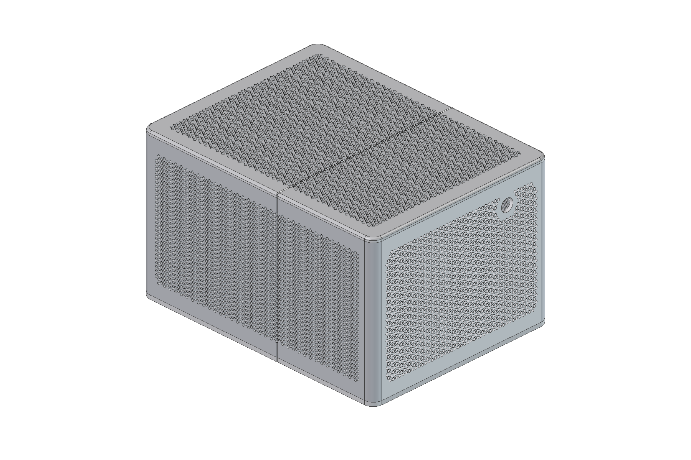
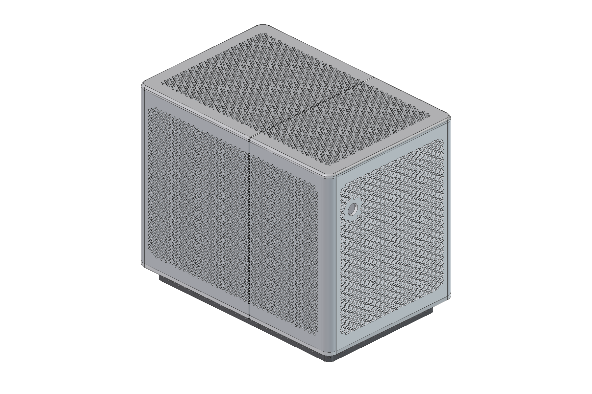
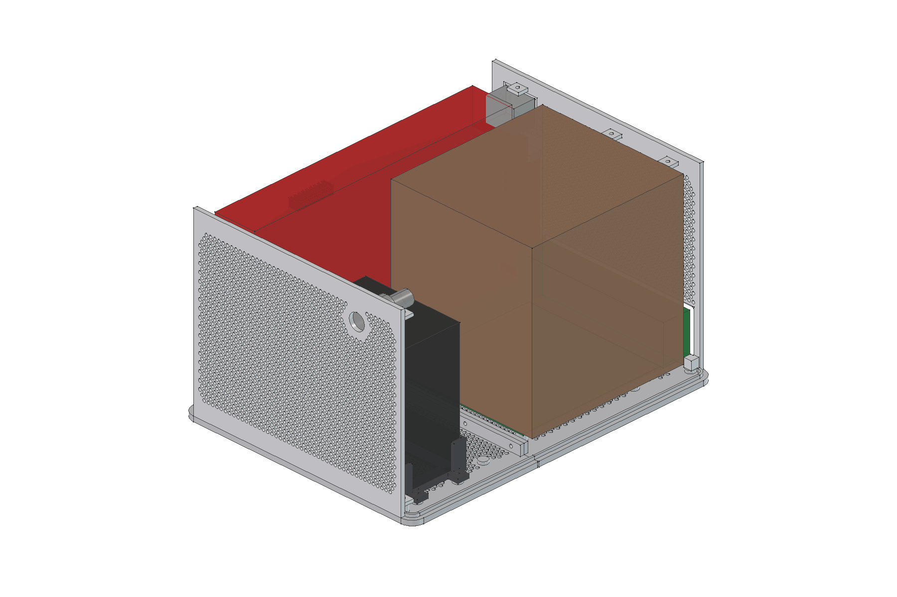

# ITX-Case – 3D-druckbares Mini-ITX-Gehäuse

Ein Gehäuse im Stil des Mac Studio für Mini-ITX-Board, Noctua NH-D15, PowerColor RX 9070 XT
Reaper und SFX-Netzteil. Die Karte steckt direkt im Slot, es gibt kein Riser-Kabel. Board,
Karte, Kühler und Netzteil bilden damit einen festen Block. Das Repo baut zwei Varianten, die
diesen Block verschieden ins Gehäuse stellen:

- **A liegend:** Das Board liegt flach auf dem Boden, der Kühler steht nach oben, die Karte steht
  senkrecht und saugt durch die linke Seitenwand an. Breit und flach.
- **B stehend:** Das Board sitzt auf einem Träger vor der rechten Seitenwand, die Karte liegt
  waagerecht und saugt durch Boden und Sockel an. Ein gewöhnlicher Tower, schmal und hoch.

Die Lüftung läuft in beiden Varianten nur über Felder aus kleinen runden Löchern: Front,
Rückwand, beide Seitenwände, der ganze Deckel, Boden und der rundum gelochte Sockel.

| | A liegend | B stehend |
|---|---|---|
| Außen (ohne Sockel) | 322 × 245 × 190 mm | 322 × 211 × 247 mm |
| Höhe mit Sockel | 202 mm | 267 mm |
| Volumen außen mit Sockel | 15,7 l | 17,8 l |
| Innen | 314 × 237 × 180 mm | 314 × 203 × 237 mm |
| GPU saugt durch | linke Seitenwand, 44,0 % offen | Boden, 41,7 % offen, Sockelring 57 cm² |
| Luft am Kühlerende | 5,4 mm zum Deckel | 12,4 mm zur linken Seitenwand |
| Druckteile | 18 | 20 (zusätzlich zwei Träger-Hälften) |
| Druckzeit / ASA (Gehäuse und Halter) | ca. 48 h / 0,7 kg | ca. 60 h / 0,9 kg |

Drucker: Voron 2.4 300, alle Teile ≤ 290 × 290 × 270 mm.

| A liegend | B stehend |
|---|---|
|  |  |
|  |  |

## Der gemeinsame Block

Eine Grafikkarte und ein Mainboard lassen sich nicht spiegeln. Liegt das Board mit der
Bestückung nach oben und der I/O-Blende hinten, dann liegt seine Slot-Kante links. Die Karte
steckt dort senkrecht im Slot, ihre Backplate zeigt zum Board, die Lüfter zeigen nach links.
Das ist Variante A. Dreht man A um die Längsachse auf die rechte Seite, entsteht B.

`params.py` beschreibt den Block in eigenen Koordinaten (u, v, w): u läuft von vorn nach
hinten, v quer zum Slot (0 ist die Wand vor den GPU-Lüftern), w ist die Höhe über der
Board-Ebene. `params.to_case` und `parts.common.place` stellen den Block ins Gehäuse. Bei A ist
die Board-Ebene der Boden, bei B die Vorderseite des Trägers.

- **Netzteil hochkant vor dem Board**, Lüfter zur Front, Rückseite mit Anschlüssen zur Wand bei
  v = `INNER_V` (A: rechte Seitenwand, B: Deckel), 25 mm Abstand für einen gewinkelten
  C13-Stecker. Vor dem D15 bleiben 64 mm Luft. Flach liegend wären es nur etwa 5 mm, dann würde
  das Netzteil die untere Hälfte des vorderen D15-Lüfters zudecken.
- **Kaltgerätebuchse** in der Rückwand über der Karte (A oben links, B unten links).
- **Taster** in der Front über dem Netzteil (A oben rechts, B oben links), mit eigener Leitung
  zum F_PANEL-Anschluss des Boards.
- **Abstandshalter 8 mm** statt 6,35 mm, damit die Rückplatte des Kühlers (6 mm angenommen)
  unter das Board passt.
- **Trennstelle bei x = 130 mm**, vor dem Kühler. So stößt kein Flansch an Kühler, Board oder
  Rückplatte.

`params.py` und `parts/` rechnen mit y von links nach rechts. Das ist ein Linkssystem, FreeCAD
rechnet rechtshändig. `build.py` spiegelt deshalb jedes Teil vor dem Export an der Ebene
y = `INNER_W` / 2. STEP, STL und `assembly.FCStd` haben die richtige Händigkeit.

Das frühere Sandwich-Layout mit Riser liegt im Tag `sandwich-v1`.

## Bauen

```bash
LAYOUT=A /Applications/FreeCAD.app/Contents/Resources/bin/freecadcmd build.py   # STEP, STL, FCStd, Prüfungen
LAYOUT=A /Applications/FreeCAD.app/Contents/MacOS/FreeCAD render.py             # PNG-Ansichten (GUI)
```

`LAYOUT=B` baut die stehende Variante. `build.py` bricht mit Exit-Code 1 ab, wenn eine Prüfung
fehlschlägt. Das Protokoll steht in `out/<LAYOUT>/report.txt`, die Teiletabelle in
`out/<LAYOUT>/parts.tsv`. Weitere Optionen per Umgebungsvariable: `GPU_PROFILE=max`,
`PSU_TYPE=SFX-L`, `QUICK=1` (nur Prüfungen, kein Export). Andere Profile landen in
`out/<LAYOUT>-<GPU>-<Netzteil>/` und sind nicht im Repo.

Die Innenmaße folgen aus dem Profil. `GPU_PROFILE=max` prüft also nicht, ob eine größere Karte in
das Reaper-Gehäuse passt, sondern baut ein größeres Gehäuse für Karten bis 340 × 140 × 65 mm
(A außen 358 × 268 × 203 mm, 20,4 l).

| Pfad | Inhalt |
|---|---|
| `params.py` | alle Maße und Optionen |
| `parts/` | ein Modul pro Bauteilgruppe (`floor`, `lid`, `side_walls`, `panels`, `tray`, `plinth`, `extras`, `dummies`) |
| `out/A/`, `out/B/` | je Variante: `step/` (Montagelage, `_baugruppe.step` komplett), `stl/` (Druckorientierung), `assembly.FCStd` mit Dummies, `png/` |

## Prüfungen (Stand des letzten Builds)

1. **Kollisionen:** Gehäuse und Halter gegen alle Dummies (Board mit I/O-Block und
   Kühler-Rückplatte, NH-D15, GPU mit Kontaktfingern, 35-mm-Kabelbogen und Slotblech, Netzteil,
   Taster mit Bauraum für die Leitung, C14): Schnittvolumen 0. Druckteile untereinander: keine
   Überschneidung. Beides gilt für A und B mit `reaper` und SFX, `reaper` und SFX-L sowie `max`
   und SFX-L.
2. **Druckbett:** Alle Teile passen nach dem Drehen in die Druckorientierung auf das Bett.
3. **Manifold:** Alle STLs sind geschlossene Körper ohne Non-Manifold-Kanten (A 18, B 20).
4. **Rückwand:** I/O-Fenster und Slotöffnung liegen in der ebenen Fläche zwischen den Eckbögen
   und überschneiden sich nicht.

## Teileliste

Die Zeiten sind grobe Schätzungen aus Volumen und Oberfläche (0,4-mm-Düse, 0,2-mm-Schicht).
Der Slicer ist maßgeblich. Die vielen Löcher kosten im Slicer mehr Zeit, als die Schätzung zeigt.
Die genauen Werte stehen in `out/<LAYOUT>/parts.tsv`.

| Teil | A: Druckmaß (mm) | B: Druckmaß (mm) | Orientierung |
|---|---|---|---|
| boden_vorn / _hinten | 134 / 188 × 245 × 15 | 134 / 188 × 211 × 15 | Unterseite aufs Bett |
| deckel_vorn / _hinten | 135 / 189 × 247 × 15 | 135 / 189 × 213 × 15 | Oberseite aufs Bett |
| seite_links / _rechts, je vorn / hinten | 134 / 188 × 14 × 180 | 134 / 188 × 14 × 237 | stehend |
| front | 180 × 221 × 14 | 237 × 187 × 14 | Sichtseite aufs Bett |
| rueckwand | 180 × 221 × 17 | 237 × 187 × 17 | Sichtseite aufs Bett |
| traeger_vorn / _hinten | – | 128 / 182 × 237 × 15 | flach, Abstandshalter oben |
| sockel_vorn / _hinten | 118 / 172 × 213 × 12 | 118 / 172 × 179 × 20 | stehend, Lippe unten |
| netzteil_halter | 71 × 128 × 28 | gleich | Bodenplatte aufs Bett |
| netzteil_klammer | 104 × 31 × 14 | gleich | flach |
| gpu_stuetze | 47 × 16 × 9 | 47 × 16 × 13 | wie eingebaut |
| kabelkamm | 38 × 10 × 8 | gleich | wie eingebaut |
| passtest_board / _rueckwand | 182 × 182 × 10 / 133 × 211 × 15 | gleich | flach |

**Zuerst die zwei Passtest-Teile drucken.** Sie prüfen die Lage von Lochbild, Slot, Slotblech
und I/O-Blende zueinander, bevor 50 bis 60 Stunden Druckzeit anfallen. Sie gelten für beide
Varianten.

## Einkaufsliste

| Teil | Menge | Hinweis |
|---|---|---|
| M3-Einschmelzmuttern, 5–5,7 mm lang, Außen-Ø ca. 4,6 | 40 | Bohrung Ø4,1, Tiefe 5,5 |
| Zylinderkopfschrauben M3 × 8 | 40 | Wandlaschen, Netzteil-Halter, Klammer, GPU-Stütze, Leiste, Sockel |
| Zylinderkopfschrauben M3 × 12 | 25 | Trennflansche (2 × 4 mm) |
| Zylinderkopfschrauben M3 × 6 | 10 | Board auf Einschmelzmuttern, GPU-Slotblech |
| M3-Muttern (DIN 934) | 25 | Flansche, Mutternkanal der GPU-Leiste |
| Neodym-Scheibenmagnete 10 × 3 mm | 16 | 8 im Deckel, 8 in den Seitenwänden, **Polung beachten** |
| C14-Einbaubuchse, Schnappbefestigung, Ausschnitt 27,5 × 19,8 mm, Wandstärke 1–2 mm | 1 | mit internem Kabel C14 auf C13 gewinkelt, ca. 50 cm |
| Vandalismus-Taster 16 mm, Taster (nicht rastend), max. 28 mm Einbautiefe | 1 | mit zweipoliger Leitung und Dupont-Buchse 2,54 mm für PWR_SW, 30–40 cm |
| Gummifüße selbstklebend, Ø8 × 2–3 mm | 8 | auf die Sockellippe |
| feines Filtergewebe, 0,2–0,3 mm Maschenweite | nach Bedarf | optional innen hinter die Lochfelder, Halter sind noch nicht modelliert |
| SFX-Netzteil ≥ 750 W | 1 | PowerColor empfiehlt für die Reaper mindestens 750 W |

## Slicer-Einstellungen (Voron 2.4, ASA)

| Einstellung | Wert |
|---|---|
| Material | ASA (bevorzugt, wärmefest) oder PETG |
| Düse / Schicht | 0,4 mm / 0,2 mm (Sichtteile 0,16 mm) |
| Perimeter | 4 (Wände 4 mm werden damit fast voll) |
| Ober-/Unterlagen | 5 / 5 |
| Infill | 25 % Gyroid |
| Stützen | **keine**, alle Teile sind stützenfrei ausgelegt |
| Bett / Düse | 105 °C / 250–260 °C (ASA), Kammer geschlossen und aufgeheizt |
| Kühlung | 20–40 % ASA, nur für Brücken mehr |
| Brim | 5 mm bei Seitenwänden und Sockel (hoch und schmal) |
| Nahtposition | hinten bzw. an der Innenseite (`Rear` / gemalt) |

Die Stege zwischen den Löchern sind 1,3 mm breit. In der Slicer-Vorschau prüfen, dass sie ohne
Lücke gefüllt sind. Falls nicht, hilft der Arachne-Wandgenerator. Einschmelzmuttern mit einer
Lötspitze bei ca. 245 °C setzen.

## Montage

Gemeinsam für beide Varianten:

1. **Passtest:** `passtest_board` mit dem Board verschrauben, `passtest_rueckwand` über die
   Zapfen stecken, Karte einstecken. Prüfen: Die I/O-Blende rastet im Fenster ein, das Slotblech
   liegt in der Öffnung, die Lasche liegt auf der Leiste auf. Abweichungen in `params.py`
   korrigieren (`ITX_HOLE_C`, `PCIE_SLOT_FROM_EDGE`, `IO_V0`, `BRACKET_TAB_ABOVE_FINGERS`,
   `GPU_FINGER_ABOVE_PCB`).
2. **Einschmelzmuttern** in alle Dome setzen, **Magnete** in Deckel und Seitenwände kleben
   (Deckel-Magnete alle mit Nordpol nach unten, Seitenwand-Magnete mit Südpol nach oben).
3. **Hälften verschrauben:** Boden, Deckel, Sockel, Seitenwände und bei B der Träger, jeweils an
   den Flanschen mit M3 × 12 und Mutter. Die V-Nut außen ausrichten, erst dann anziehen.
4. **Sockel unter den Boden** schrauben, Gummifüße auf die Lippe kleben.
5. **Front** mit Taster und **Rückwand** mit C14-Buchse auf den Boden stellen und verschrauben.

Variante A:

6. Rückwand zusätzlich unten von unten durch den Boden in die zwei Nasen schrauben (die
   I/O-Blende reicht fast bis zum Boden, dort ist kein Platz für Laschen).
7. Netzteil-Halter auf den Boden, Netzteil hochkant hineinstellen (Lüfter zur Front,
   Anschlüsse nach rechts), Klammer aufsetzen und verschrauben.
8. Board mit montierter Kühler-Rückplatte auf die Abstandshalter im Boden schrauben, D15
   montieren (Lüfter blasen nach hinten).
9. Karte einstecken, Lasche auf der Leiste verschrauben, GPU-Stütze unter die Vorderkante
   schieben.
10. Deckel aufsetzen und über die Laschen von Front und Rückwand verschrauben, Seitenwände
    einhängen.

Variante B:

6. Netzteil-Halter und Board (mit Kühler-Rückplatte) auf den Träger schrauben. Kabel durch die
   Durchbrüche nach hinten führen. Der D15 kann später montiert werden, der Träger hat hinter
   dem Sockel einen Ausschnitt.
7. Träger in den Boden stellen und unten über die Laschen verschrauben.
8. Netzteil einsetzen (Lüfter zur Front, Anschlüsse nach oben), Klammer verschrauben, D15
   montieren.
9. Karte einstecken, Lasche verschrauben, GPU-Stütze unter die Vorderkante schieben.
10. Deckel aufsetzen und über die Laschen von Front, Rückwand und Träger verschrauben,
    Seitenwände einhängen.

## Luftstrom und freie Querschnitte

Die Löcher haben Ø3,2 im Wabenraster mit 4,5 mm Abstand (theoretisch 45,9 % offen), im Sockel
Ø3,8 mit 5 mm Abstand. In Deckel, Seitenwänden und Sockel laufen die Felder ohne Lücke über die
Trennfuge. Wo innen ein Flansch, ein Dom oder eine Magnetnase hinter dem Feld sitzt, sind die
Löcher Sacklöcher mit 0,6 mm Haut (`VENT_BLIND_SKIN`) und zählen nicht zum Querschnitt.

| | A liegend | B stehend |
|---|---|---|
| Front | 139 cm² | 160 cm² |
| Rückwand | 84 cm² + Slotblech ca. 19 cm² | 94 cm² + Slotblech ca. 19 cm² |
| Seitenwand, je Seite | 190 cm² | 266 cm² |
| Deckel | 264 cm² | 212 cm² |
| Boden über dem Sockel | 228 cm² | 193 cm² |
| Sockelring | 37 cm² | 57 cm² (Ring 20 mm hoch) |

Zum Vergleich: drei 95-mm-Lüfter der Karte haben ca. 194 cm² freie Fläche, die zwei
140-mm-Lüfter des D15 ca. 277 cm².

- **A:** Die Karte saugt geradeaus durch die linke Seitenwand an, 17 mm vor den Lüftern. Der D15
  saugt durch die Front an (über und neben dem Netzteil) und bläst durch Rückwand und Deckel aus.
- **B:** Die Karte saugt durch den Boden an. Der Sockelring ist die Engstelle: Mit 57 cm²
  liefert er weniger als ein Drittel der Lüfterfläche, den Rest holt die Karte über die
  Seitenwände und die Front. `build.py` warnt deshalb. Die warme Luft steigt zum Deckel, der D15
  bläst von vorn nach hinten.

Der offene Deckel hat einen Preis: Staub und verschüttete Flüssigkeit fallen direkt auf Board
und Karte. Bei B zieht der Boden zusätzlich Staub vom Tisch an. Mit feinem Filtergewebe innen
hinter den Feldern funktionieren beide Varianten, bei B ist ein Filter am Boden Pflicht.

## Entscheidungen

- **Kein Riser.** Die Karte steckt direkt im Slot. Damit fallen Mittelwand, Riser-Halter und das
  Risiko von PCIe-5.0-Signalfehlern weg.
- **Eckradius 12 mm** statt 22 mm. I/O-Blende und Slotblech brauchen zusammen gut 205 mm ebene
  Rückwand. Mit 22 mm wäre das Gehäuse rund 20 mm breiter geworden. Der Sockel hat einen eigenen
  Eckradius von 8 mm.
- **Innenmaße aus dem GPU-Profil.** Das Standardgehäuse ist für die Reaper gebaut (304 × 127 ×
  42 mm). Eine größere Karte braucht ein neu gebautes Gehäuse mit `GPU_PROFILE=max`.
- **B mit Träger statt Board an der Seitenwand.** Die Seitenwände sind abnehmbare Schalen mit
  Magneten. Der Träger steht 11 mm vor der rechten Wand, dort haben die Flansche der Seitenwand
  Platz, und dahinter laufen die Kabel. Das kostet B rund 16 mm Breite.
- **B mit 20 mm hohem Sockel** statt 12 mm, weil die Karte durch den Boden ansaugt.
- **Netzteil-Halter mit Klammer:** Wanne mit vollen Wänden an der blanken Seite und zum Kühler,
  an Lüfter und Anschlüssen nur Ecken. Eine Klammer an der blanken Seite greift über die
  Oberkante.
- **Rückwand von A unten von unten verschraubt.** I/O-Blende und Slotblech reichen bis 5 mm über
  den Boden. Für Laschen wie an der Front ist dort kein Platz.
- **Lochbild, Sacklöcher, Deckelkante, V-Nut, stützenfreie Flansche** wie im bisherigen Stand.

## Unsicher – mit dem Passtest prüfen

| Maß | Wert in `params.py` | Stand |
|---|---|---|
| Kartenebene ab Slot-Kante | `PCIE_SLOT_FROM_EDGE` = 10 mm | geschätzt, legt die Lage von Karte, Slotblech und Kühler quer fest |
| I/O-Fenster entlang der Kante | `IO_V0` = 2 mm neben der Backplate-Ebene | Größe und Höhe aus ATX 2.2 (Text), die Lage zum Slot war in der Norm-Zeichnung nicht lesbar |
| Fingerunterkante über dem Board | `GPU_FINGER_ABOVE_PCB` = 3 mm | geschätzt aus der Steckplatzhöhe |
| ITX-Lochbild | C, F, H, J mit 154,94 / 157,48 / 22,86 mm | Rasterwerte aus ATX/microATX, Kante-Abstände aus Zeichnungen |
| PCIe-Slotblech | Länge 120,02, Lasche 112 über der Fingerunterkante | Slotabstand 20,32 sicher, der Rest geschätzt |
| NH-D15-Höhe | 165 mm ab Platine | für den NH-D15 G2 168 mm (`COOLER_PROFILE = "NH-D15 G2"`, bei A bleiben dann 2,4 mm) |
| Reaper-Maße | 304 × 127 × 42 mm mit Blech | Händlerangaben |
| Sockellage | 90 mm von I/O, 105 mm von der Slot-Kante | Parameter, für das kommende Board anpassen |
| Netzteil und C14 | SFX 125 × 63,5 × 100; C14-Schnappbuchse 27,5 × 19,8 | Typ festgelegt, konkretes Modell offen |
